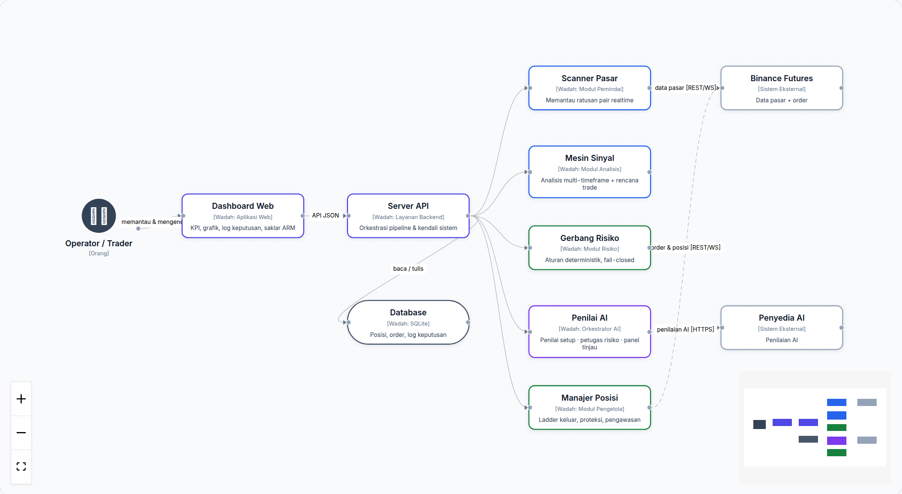
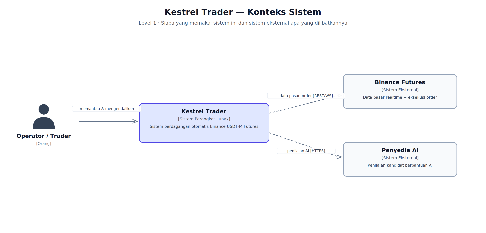
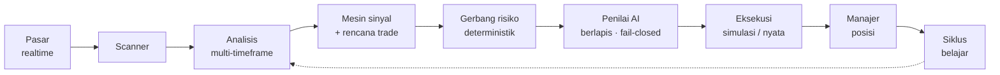
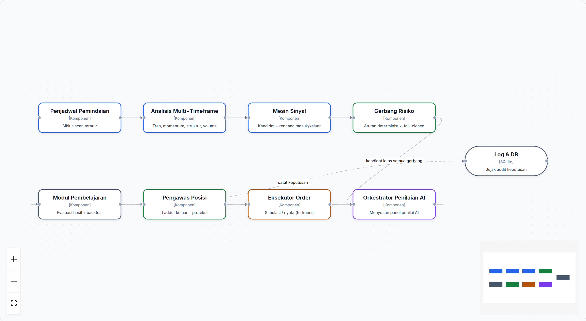
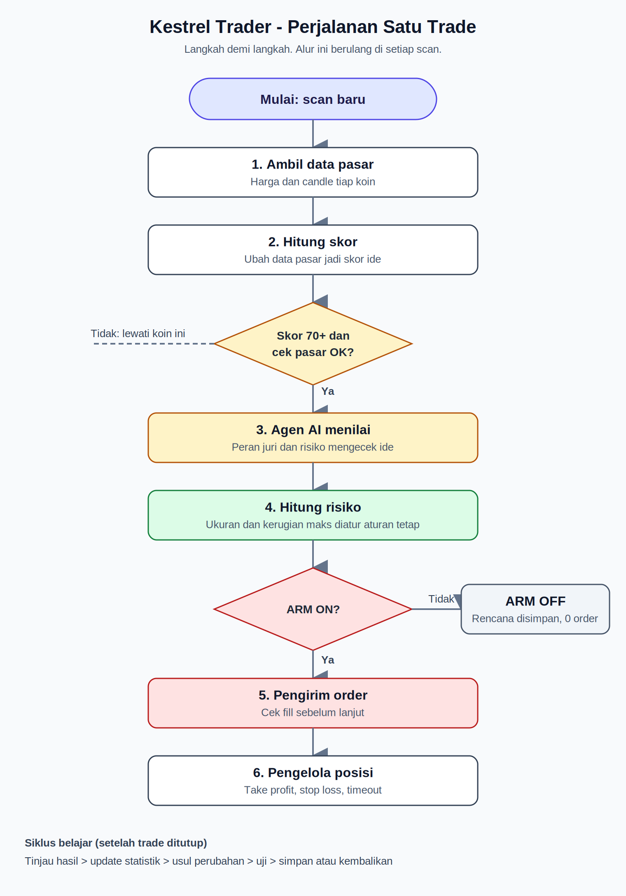

<div align="center">

# Kestrel Trader

### Sistem Perdagangan Otomatis untuk Binance USDT-M Futures

**Pemantauan pasar realtime · Sinyal multi-timeframe · Penilaian AI berlapis · Manajemen posisi otomatis · Dashboard lengkap**

[](LICENSE)
[](https://nodejs.org)
[-2563eb.svg)](#mode-aman)
[-dc2626.svg)](#mode-aman)



</div>

---

## Daftar Isi

- [Tentang](#tentang)
- [Fitur Unggulan](#fitur-unggulan)
- [Arsitektur Sistem](#arsitektur-sistem)
- [Cara Kerja](#cara-kerja)
- [Mode Aman](#mode-aman)
- [Instalasi Cepat](#instalasi-cepat)
- [Struktur Proyek](#struktur-proyek)
- [Teknologi](#teknologi)
- [Disclaimer & Lisensi](#disclaimer--lisensi)

---

## Tentang

**Kestrel Trader** adalah sistem perdagangan otomatis (trading bot) untuk pasar
Binance USDT-M Futures yang dirancang dengan prinsip utama: **keamanan lebih dulu,
keputusan bisa diaudit, dan setiap langkah tervalidasi**.

Sistem ini bekerja penuh secara end-to-end — dari memantau ratusan pair secara
realtime, membaca kondisi pasar melalui analisis multi-timeframe, menghasilkan
sinyal perdagangan yang lengkap dengan rencana masuk dan keluar, menilai setiap
kandidat melalui beberapa lapisan peninjauan (deterministik **dan** berbantuan
AI), mengeksekusi serta mengelola posisi secara otomatis, hingga belajar dari
hasil setiap perdagangan.

Setiap keputusan sistem — termasuk alasan sebuah kandidat **ditolak** — tercatat
sehingga Anda dapat mengaudit perilakunya kapan saja.

## Fitur Unggulan

<details open>
<summary><b>📡 Scanner Pasar Realtime</b></summary>

- Memantau seluruh pair futures yang memenuhi syarat likuiditas, dengan
  kombinasi REST dan WebSocket.
- Harga, volume, dan status koneksi disegarkan terus-menerus; data yang tidak
  segar secara otomatis tidak dipakai untuk keputusan apa pun.
- Filter kelas aset dan ambang volume diterapkan sebelum sebuah pair masuk
  kandidat.
</details>

<details open>
<summary><b>🧠 Mesin Sinyal Multi-Timeframe</b></summary>

- Menganalisis tren, momentum, struktur harga, volatilitas, dan profil volume
  di beberapa timeframe sekaligus.
- Setiap sinyal lahir lengkap dengan **rencana masuk, level invalidasi, dan
  rencana keluar** yang tervalidasi — bukan tebakan harga.
- Semua perhitungan bersifat deterministik dan dapat direproduksi dari data
  yang sama.
</details>

<details open>
<summary><b>⚖️ Gerbang Risiko Deterministik</b></summary>

- Validasi ukuran posisi, jarak proteksi, dan batas penggunaan margin — semuanya
  berbasis aturan matematis, bukan keputusan subjektif.
- Perlindungan dari likuidasi, batas kerugian harian, jeda antar-entri, dan
  penjaga volatilitas ekstrem.
- Prinsip *fail-closed*: jika ada yang tidak pasti, kandidat ditolak.
</details>

<details open>
<summary><b>🤖 Penilaian AI Berlapis</b></summary>

- **Penilai setup** — menilai kualitas dan kelayakan sebuah setup.
- **Petugas risiko** — memvalidasi rencana risiko setiap posisi.
- **Panel tinjau pra-eksekusi** — beberapa peran peninjau memberikan suara;
  eksekusi hanya terjadi bila ada persetujuan.
- Semua penilaian AI bersifat *fail-closed*: keterlambatan, error, atau suara
  yang tidak lengkap dihitung sebagai **penolakan**.
</details>

<details open>
<summary><b>🎯 Manajemen Posisi Otomatis</b></summary>

- Pengeluaran bertingkat (staged take-profit) dan pemindahan stop ke titik
  impas secara otomatis.
- Pengawas posisi (supervisor + watchdog) yang memantau posisi terbuka
  terus-menerus, termasuk kondisi darurat.
- Rekonsiliasi berkala antara database dan posisi nyata di exchange.
</details>

<details open>
<summary><b>📊 Dashboard Web Realtime</b></summary>

- KPI trading, grafik kurva ekuitas dan posisi, riwayat perdagangan.
- Log keputusan lengkap: kandidat apa yang dinilai, oleh siapa, dan mengapa
  diterima/ditolak.
- Pembaruan harga dan P&L realtime via WebSocket, kontrol saklar eksekusi (ARM).
</details>

<details open>
<summary><b>🔁 Siklus Belajar Berkelanjutan</b></summary>

- Evaluasi hasil setiap perdagangan dan analisis kesalahan proses.
- Fasilitas backtest untuk menguji ide tanpa risiko nyata.
- Katalog riset strategi untuk pengembangan berkelanjutan.
</details>

<details open>
<summary><b>🛡️ Operasional & Ketahanan</b></summary>

- Watchdog proses, penjaga rate-limit exchange dengan backoff otomatis.
- Backup database terjadwal dan skrip rilis dengan **rollback otomatis**.
- Audit trail setiap keputusan tersimpan di database.
</details>

## Arsitektur Sistem

Dokumentasi arsitektur lengkap mengikuti standar **C4 model** (Konteks → Wadah →
Komponen), tersedia dalam Bahasa Indonesia:

| Level | Diagram | Gambar |
|---|---|---|
| 1 | **Konteks Sistem** — siapa yang memakai dan sistem eksternal yang terlibat |  |
| 2 | **Wadah** — struktur teknis utama di dalam sistem |  |
| 3 | **Komponen** — alur satu kandidat di dalam mesin inti |  |

Penjelasan tiap level: **[docs/id/04-arsitektur-c4.md](docs/id/04-arsitektur-c4.md)**

## Cara Kerja

Ringkasnya, setiap kandidat melewati alur berikut:



Diagram alur yang lebih rinci:

| | |
|---|---|
| Pipeline dari sinyal ke order |  |
| Kehidupan satu perdagangan |  |

Detail lengkap + diagram interaktif: **[docs/id/02-alur-kerja-workflow.md](docs/id/02-alur-kerja-workflow.md)**

## Mode Aman

Keselamatan dana adalah prioritas pertama:

1. **Mode default = simulasi (PAPER).** Seluruh alur berjalan penuh — sinyal,
   penilaian, "order" simulasi, manajemen posisi — tanpa menyentuh exchange.
2. **Saklar eksekusi (ARM) selalu OFF secara bawaan** dan tidak menyala
   otomatis saat sistem restart. Mengaktifkannya adalah langkah manual yang
   disengaja.
3. API key tidak pernah dicatat ke log, ditampilkan di UI, atau masuk repositori.

## Instalasi Cepat

```bash
git clone https://github.com/Sorosjenaka/Kestrel-Trader.git
cd Kestrel-Trader
cp .env.example apps/server/.env   # lalu isi API key Anda
npm install
npm run build
npm run dev:server                  # mesin trading + API
npm run dev:web                     # dashboard (terminal lain)
```

Verifikasi: `npm run health` → harus merespons status `ok` dengan mode `PAPER`.

Tutorial lengkap langkah demi langkah (termasuk konfigurasi, verifikasi, dan
pindah ke mode nyata dengan aman):
**[docs/id/03-tutorial-pasang.md](docs/id/03-tutorial-pasang.md)**

## Struktur Proyek

```
Kestrel-Trader/
├── apps/
│   ├── server/        # mesin trading: scanner, sinyal, risiko, eksekusi, API
│   └── web/           # dashboard web realtime
├── packages/          # paket bersama
├── prisma/            # skema database
├── deploy/            # skrip rilis & rollback otomatis
├── tools/             # utilitas operasional
├── docs/
│   ├── id/            # panduan Bahasa Indonesia ← mulai dari sini
│   ├── public/        # dokumentasi arsitektur (EN)
│   └── diagrams/      # diagram pipeline, workflow, dan C4
└── .env.example       # template konfigurasi (tanpa rahasia)
```

## Teknologi

| Lapisan | Teknologi |
|---|---|
| Backend / mesin | Node.js ≥ 20, TypeScript |
| Frontend | React, Vite |
| Database | SQLite (via Prisma) |
| Data pasar | Binance USDT-M Futures (REST + WebSocket) |
| Penilaian AI | Integrasi penyedia LLM (fail-closed) |
| Diagram | C4 model |

## Disclaimer & Lisensi

> Trading aset kripto berisiko tinggi dan dapat mengakibatkan kehilangan
> seluruh modal. Perangkat lunak ini disediakan **apa adanya** tanpa jaminan
> apa pun. Penggunaan sepenuhnya menjadi tanggung jawab pengguna. Performa
> masa lalu tidak menjamin hasil di masa depan.

Distribusi di bawah lisensi **MIT** — lihat [LICENSE](LICENSE).
