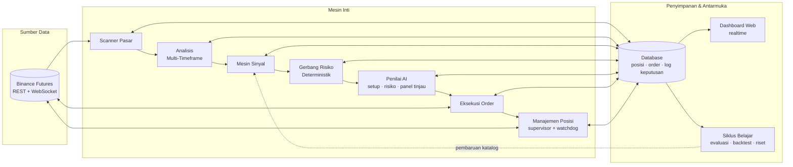
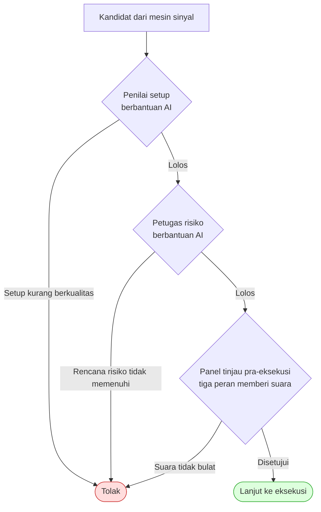
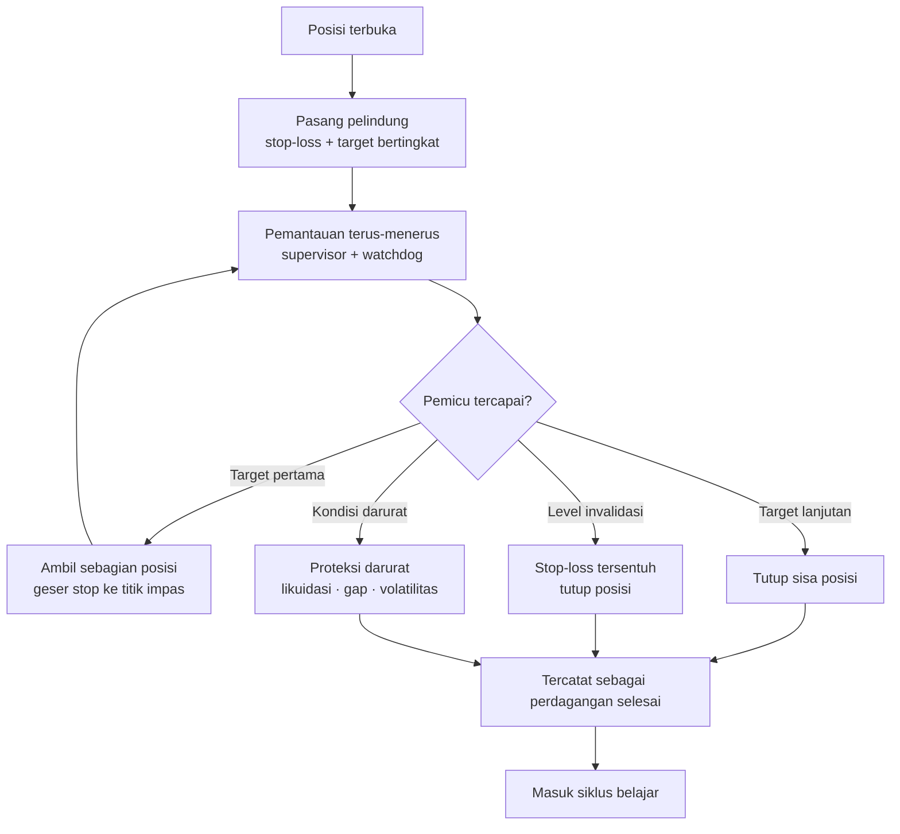
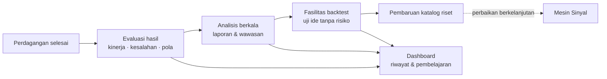

# Alur Kerja dan Struktur Workflow

Dokumen ini memuat struktur sistem dan alur kerja lengkap Kestrel Trader,
dari pengamatan pasar sampai siklus pembelajaran. Setiap bagian dilengkapi
diagram (Mermaid — render otomatis sebagai gambar di GitHub).

Gambar statis versi PNG juga tersedia:

- Pipeline: [kestrel-pipeline-id.png](../diagrams/kestrel-pipeline-id.png)
- Workflow: [kestrel-workflow-id.png](../diagrams/kestrel-workflow-id.png)

---

## 1. Struktur sistem

Komponen utama dan bagaimana mereka saling terhubung:



---

## 2. Pipeline perdagangan (dari sinyal ke posisi)

Setiap kandidat melewati rangkaian gerbang berurutan. Semua penolakan
tercatat beserta alasannya.

```mermaid
flowchart TD
    A[Pembaruan data pasar] --> B[Analisis multi-timeframe]
    B --> C{Setup valid?}
    C -->|Tidak| X1[Lewati — tercatat]
    C -->|Ya| D[Bentuk rencana perdagangan<br/>masuk · invalidasi · keluar]
    D --> E{Gerbang likuiditas<br/>& jarak harga}
    E -->|Gagal| X2[Tolak — tercatat]
    E -->|Lolos| F{Validasi risiko<br/>ukuran · margin · proteksi}
    F -->|Gagal| X3[Tolak — tercatat]
    F -->|Lolos| G{Penilai AI<br/>setup + risiko}
    G -->|Tolak / timeout| X4[Tolak — tercatat]
    G -->|Lolos| H{Panel tinjau<br/>pra-eksekusi (voting)}
    H -->|Tidak setuju / timeout| X5[Tolak — tercatat]
    H -->|Setuju| I[Kirim order<br/>simulasi atau nyata]
    I --> J{Order terisi?}
    J -->|Tidak / kedaluwarsa| X6[Batalkan — tercatat]
    J -->|Ya| K[Posisi terbuka<br/>masuk manajemen posisi]
```

Catatan penting: semua penilai AI bersifat **fail-closed** — jika penilai
tidak tersedia, terlambat, atau gagal, kandidat **ditolak**, tidak pernah
dibiarkan lolos diam-diam.

---

## 3. Alur keputusan penilaian (detail)



---

## 4. Manajemen posisi (setelah order terisi)



---

## 5. Siklus belajar berkelanjutan



---

## Ringkasan alur

Data pasar → analisis multi-timeframe → sinyal tervalidasi → gerbang risiko
deterministik → penilai AI (fail-closed) → eksekusi (simulasi/nyata) →
manajemen posisi otomatis → pembelajaran → perbaikan mesin sinyal.

Untuk cara memasang sistemnya, lanjut ke [03-tutorial-pasang.md](03-tutorial-pasang.md).
