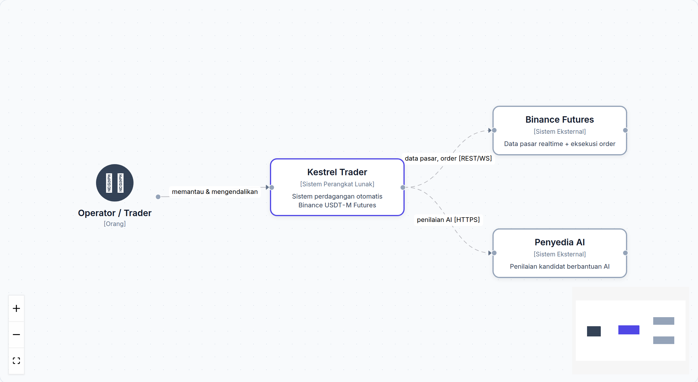
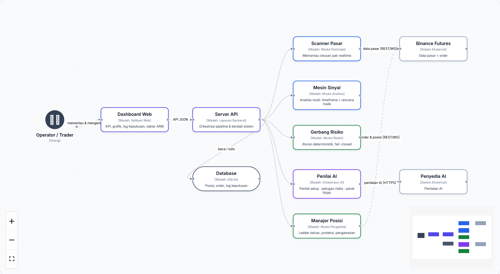
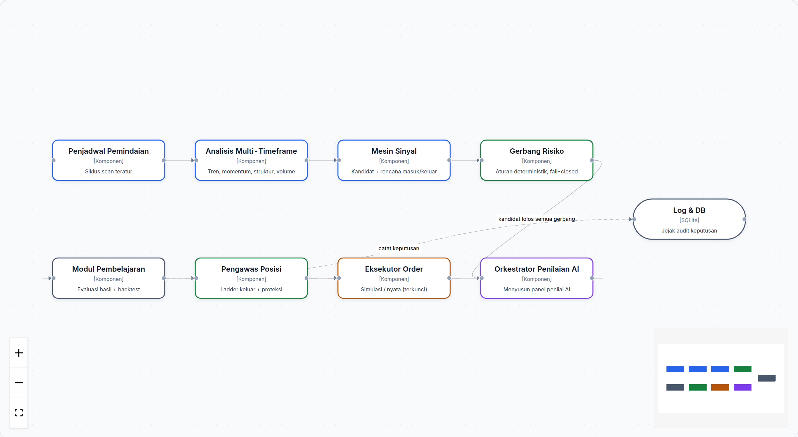

# Arsitektur Sistem (Model C4)

Dokumen ini menjelaskan arsitektur Kestrel Trader menggunakan **C4 model** —
cara menggambarkan perangkat lunak dalam tiga tingkat kedalaman: **Konteks →
Wadah → Komponen**. Setiap tingkat menjawab pertanyaan yang berbeda: siapa yang
memakai sistem, apa saja isinya, dan bagaimana satu pekerjaan mengalir di
dalamnya.

Semua gambar di dokumen ini adalah screenshot dari **diagram interaktif React
Flow** yang tersedia di dashboard (menu **Diagram**, rute `#/diagram`) — di
sana Anda dapat menggeser node, memperbesar, dan menelusuri tiap koneksi.

---

## Level 1 — Konteks Sistem

> *Siapa yang memakai sistem ini, dan sistem eksternal apa yang dilibatkannya?*

- **Operator / Trader** — Anda. Memantau kinerja, mengonfigurasi sistem, dan
  memegang kendali penuh atas saklar eksekusi.
- **Kestrel Trader** — sistem perdagangan otomatis yang menjalankan seluruh
  alur: pemindaian, analisis, penilaian, eksekusi, dan pengelolaan posisi.
- **Binance Futures** — sumber data pasar realtime sekaligus tempat order
  dieksekusi (melalui REST + WebSocket).
- **Penyedia AI** — layanan model bahasa yang membantu penilaian kandidat
  (kualitas setup dan rencana risiko) melalui HTTPS.

---

## Level 2 — Wadah (Container)

> *Teknologi apa saja yang membentuk sistem, dan bagaimana mereka saling bicara?*

| Wadah | Peran |
|---|---|
| **Dashboard Web** | Antarmuka operator: KPI, grafik posisi, log keputusan, saklar ARM |
| **Server API** | Pusat orkestrasi: menjadwalkan pipeline dan meneruskan kerja ke modul |
| **Scanner Pasar** | Memantau ratusan pair futures secara realtime |
| **Mesin Sinyal** | Analisis multi-timeframe + penyusunan rencana perdagangan |
| **Gerbang Risiko** | Validasi aturan risiko deterministik (fail-closed) |
| **Penilai AI** | Orkestrasi penilai setup, petugas risiko, dan panel tinjau |
| **Manajer Posisi** | Pengeluaran bertingkat, proteksi, dan pengawasan posisi |
| **Database** | Penyimpanan posisi, order, dan jejak audit keputusan |

Koneksi eksternal: **REST/WebSocket** ke Binance Futures, **HTTPS** ke
penyedia AI. Semua keputusan mengalir melalui Server API dan tercatat di
database.

---

## Level 3 — Komponen (Mesin Inti)

> *Bagaimana satu kandidat mengalir dari pemindaian sampai pembelajaran?*

Urutan alur satu kandidat:

1. **Penjadwal Pemindaian** — menjalankan siklus scan secara teratur.
2. **Analisis Multi-Timeframe** — membaca tren, momentum, struktur harga, dan volume.
3. **Mesin Sinyal** — menyusun kandidat lengkap dengan rencana masuk/keluar.
4. **Gerbang Risiko** — memvalidasi aturan risiko secara deterministik;
   sesuatu yang tidak pasti = ditolak.
5. **Orkestrator Penilaian AI** — menyusun panel penilai (setup, risiko, tinjau).
6. **Eksekutor Order** — mengirim order (simulasi atau nyata, tergantung mode).
7. **Pengawas Posisi** — mengelola pengeluaran bertingkat dan proteksi posisi.
8. **Modul Pembelajaran** — mengevaluasi hasil dan memperbarui katalog riset.

Semua keputusan penting dicatat ke **Log & DB** sebagai jejak audit.

---

## Prinsip desain

- **Fail-closed di mana pun ada ketidakpastian** — data tidak segar, penilai
  tidak tersedia, atau aturan tidak terpenuhi berarti *tidak ada eksekusi*.
- **Semua keputusan tercatat** — termasuk penolakan beserta alasannya.
- **Pemisahan kendali eksekusi** — mode simulasi dan saklar eksekusi nyata
  adalah dua lapis pengaman terpisah.

Kembali ke [index panduan](README.md).
