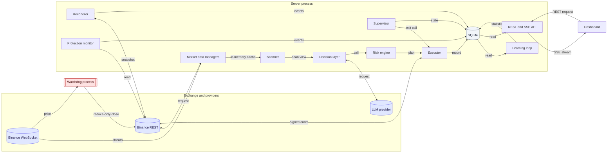

# Component Interaction Diagram

Shows which components communicate and how. Line styles encode the mechanism.

## Legend

| Arrow | Meaning |
|---|---|
| `-->` | One-way data or call |
| `<-->` | Request and response |
| `-->|stream|` | Continuous WebSocket data |
| `-->|SSE stream|` | Server-sent events to the browser |

- **Blue**: external services.
- **Grey**: persistence.
- **Red**: the independent watchdog process, which sends closes without going through the server.
- The watchdog reads the price stream directly. It does not read the server's in-memory state.
