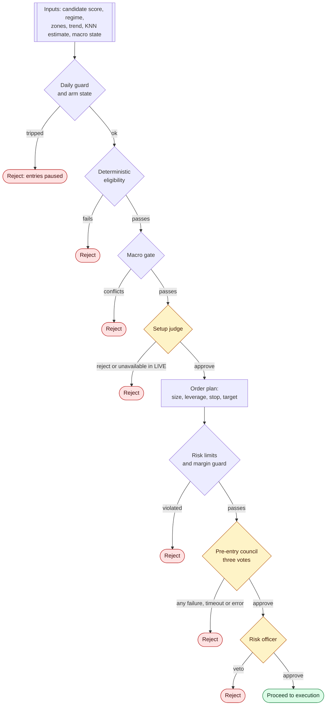

# Decision-Making Flowchart

Shows which information enters the decision layer, how each check is applied, and when a candidate is rejected.

## Reading the diagram

- **Amber** diamonds are LLM-backed decisions. The council is fail-closed: missing, late, or errored votes count as rejection.
- Every rejection is recorded with the stage that produced it.
- Only a candidate that clears all checks reaches execution.
- The thresholds used in the checks are configuration and are not shown.
