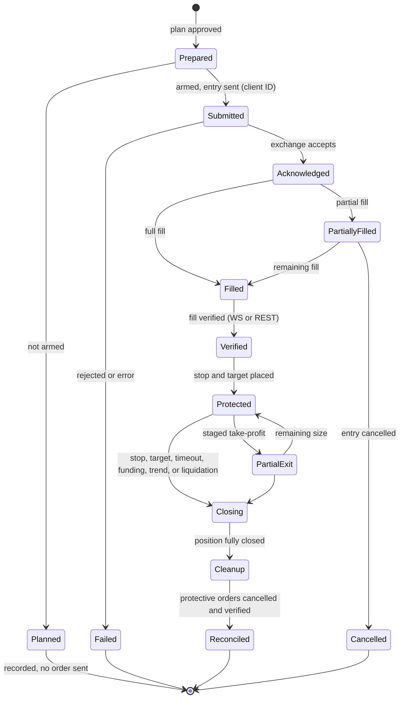

# Order Lifecycle Diagram

Shows how an order moves from preparation to cleanup, including partial fills, protective orders, and reconciliation.

## Reading the diagram

- **Idempotency** holds across the Submitted and Acknowledged states: a retry reuses the same client ID.
- **Partial fills** are tracked until the entry is complete or cancelled.
- **Protected** means a stop is in place. Targets are staged and the stop may move after a configured stage.
- **Cleanup** runs only after a full close. Orders that cannot be attributed to the closed position are left untouched.
- **Reconciled** means the exchange state was confirmed against the database.
