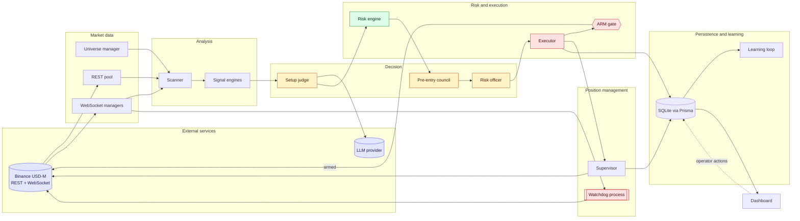

# System Overview Diagram

Shows the main components, the external services they depend on, and the direction of data flow.

## Reading the diagram

- **Blue** nodes are external services.
- **Amber** nodes are decision steps that may use an LLM.
- **Green** is the deterministic risk step.
- **Red** nodes are the execution path. Orders reach the exchange only through the ARM gate.
- The **watchdog** reads the same price stream as the scanner and sends protective closes directly, so it does not depend on the server.
- Dashed arrows are operator actions, not automated flow.
