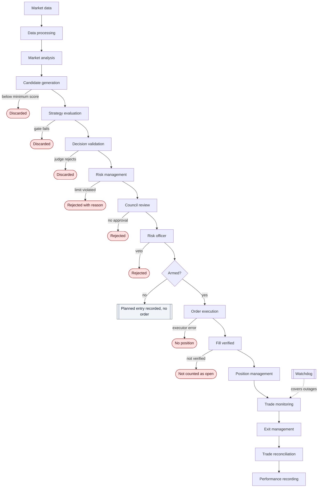

# Trading Pipeline Diagram

Shows the full pipeline from market data to performance recording, including rejection branches.

## Reading the diagram

- Each rejection is recorded with its reason. A rejected candidate does not reach execution.
- The **Armed?** check is the boundary between planning and sending. Without ARM, the pipeline ends at a planned entry.
- Trade monitoring is continuous; the diagram shows it as a single step for readability.
- The dashed watchdog link is an independent path for protective exits.
